# Unlock Encrypted Data with a Fiber Payment.
**Name**: Teresia Mkarie 
**Date**:  24th-11-2026 

I completed the Basic Quest that entailed `Unlocking Encrypted Data  with a Fiber Payment` from the [Encrypted-Data-Payment](https://www.fiber.world/docs/build/encrypted-data-payment).

## Proofs On My Working.
### 1.Setup The Nodes
Both Channels for the two Nodes successfully showed `CHANNEL_READY` for the setup to be approved to the next task's step.
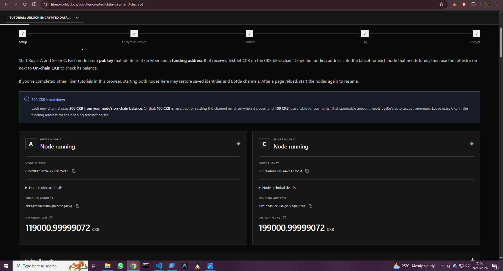

### 2.Channel Ready
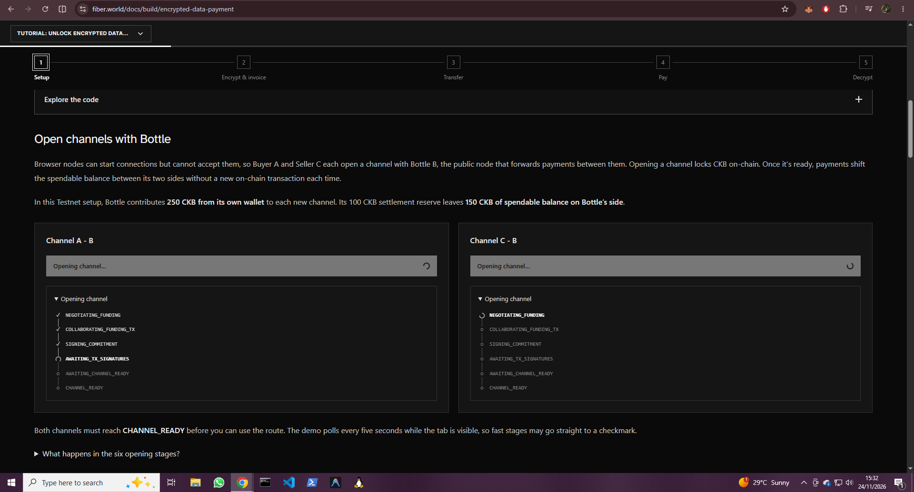

### 3.Invoice Created
Seller C used the `AES Key` as the invoice's payment preimage.The invoice which is a request for the payment was created successfully.
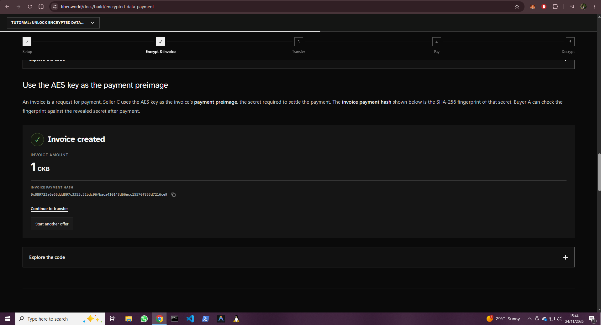
 
 ### 4.Before Payment
 The Decryption rejected message from the buyers encrypted offer.
 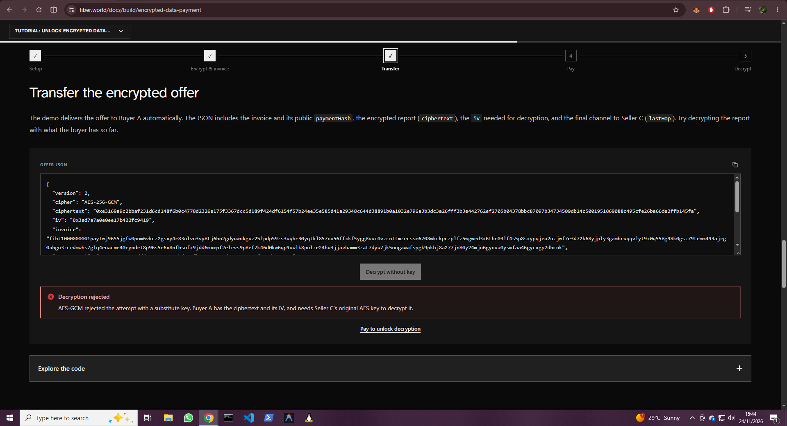
  
### 5.After Payment
The completed payment receipt that showed successful payment of `1CKB` and the `Payment hash`.
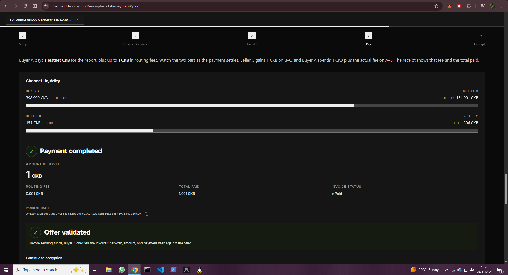

### 6.After Decryption 
The Buyer's decrypted result that matched the seller's original text.
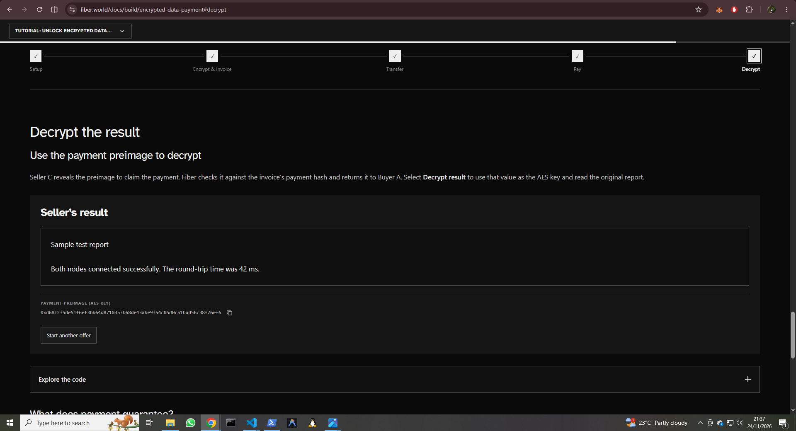
 
### 7.Answered Question to Tutorial.
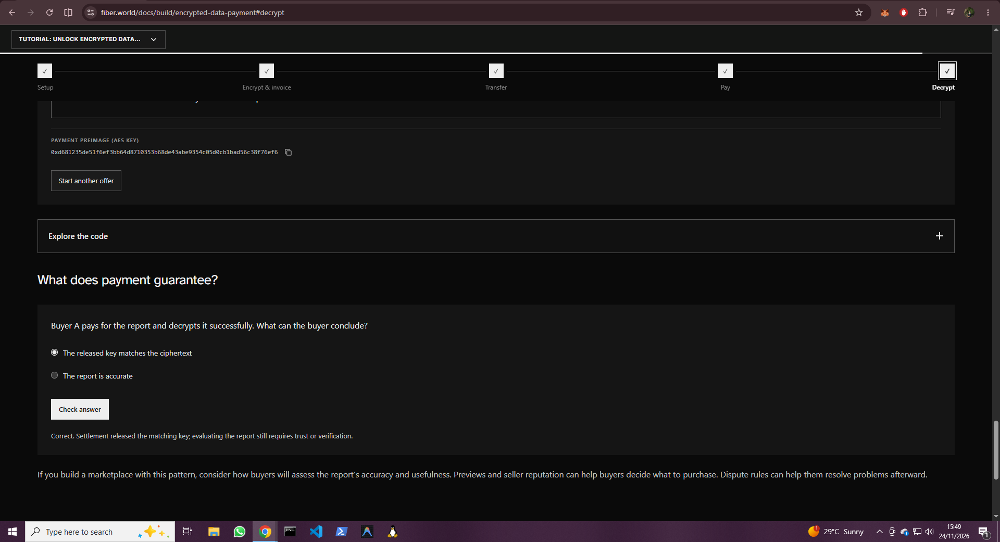

## My Reflection
- This not being my first Fiber Tutorial I reused my saved nodes, so there was no fresh  setup.Waited for the nodes to be running.I treated `Sender A` and `Receiver C` as two separate entities, each with its own node and funds.
- Before I  paid,the Buyer couldn't decrypt the offer,and as i continued along, the key stayed hidden until the invoice settled.Seeing the rejection message for the decrytion then watching the same offer decrypt after payment.
## Required Question
- With the explanation alongside each interactive step it eased my working with unlocking the encrypted data using Fiber Payment.
- I preferred the previous layout, where the demo was at the top and the walkthrough below because the explanations beside each step  were clear but pulled me away from my attention away from the demo itself.
 
## My Honest Opinions on What I learnt.
### What Surprised Me.
I realised that the payment itself releases the key and the seller never has to trust the buyer; once the 1CKB invoice is settled, the same offer that was initially rejectedbefore payment can now be decrypted.Then also,the **Receipt** showed a routing fee of only `0.001CKB`.
### If you could change one thing about the tutorial, what would it be?
If I could change one thing, it would be how the decryption result appears after payment.Intially I thought it was an error I ran into I had to find out that it was after payment was successfully settled is when the decryption would be accepted and not vice versa where payment first then decrytpion below sequentially. 

## Advanced--Build Your Own Pay-To-Unlock Demo.
I downloaded the starter project from the `downloadable Starter kit`, followed its `README` and ran it locally.

## Proofs on Tutorial_2
Both channels for `Buyer A` and `Seller C` ran successfully indicating the `CHANNEL_READY` status.
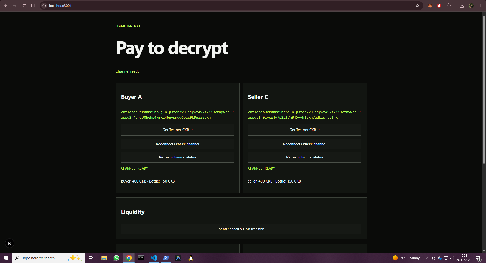

### Liquidity Transfer
I sent/Checked the 5 CKB transfer and the app showed liquidity Transfer Success.
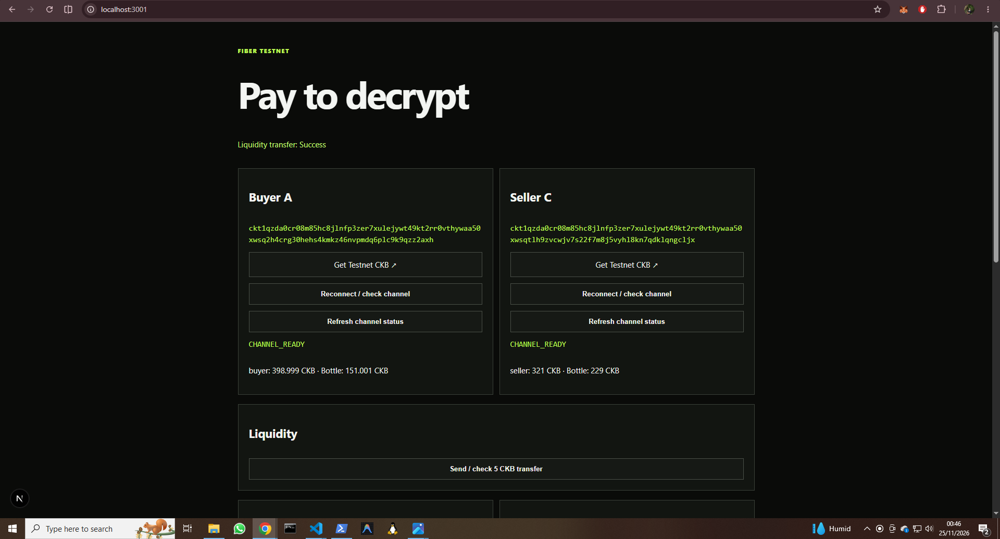

### Encrypt and Create 1CKB Invoice
I encrypted the sellers Text which automatically provided the `JSON` file to which I copied the Offer into the `Buyer's Field`,`validated it` then paid its 1CKB invoice.
 
### Payment Successful
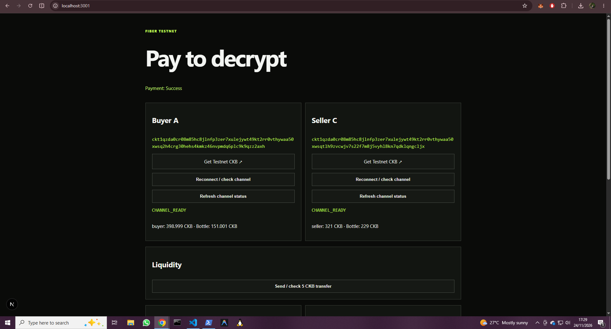

### Receipt of Payment 
Having validated the offer and making the 1CKB payment invoice, a receipt was generated showing the `total amount paid` and the `routing fee`.
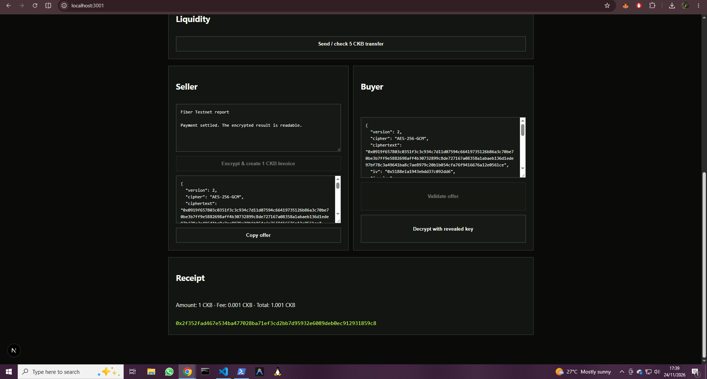

### Decrypted Result
The decrypted Result matched the Sellers text that was initially encrypted as shown below:
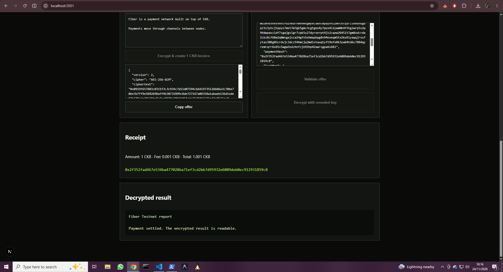

### Running Typecheck,Testing and building.
Running the typecheck and tests were successful.
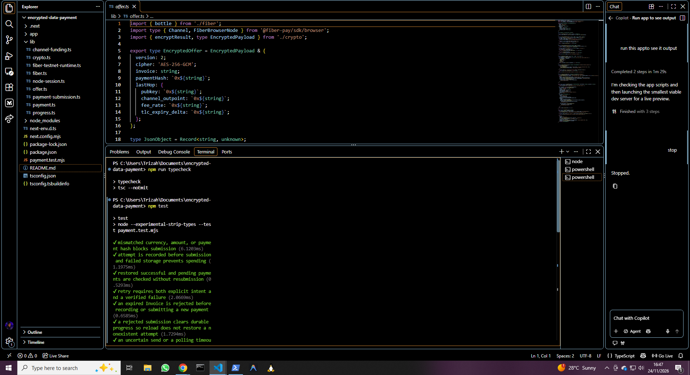
  
## Problems I encountered
 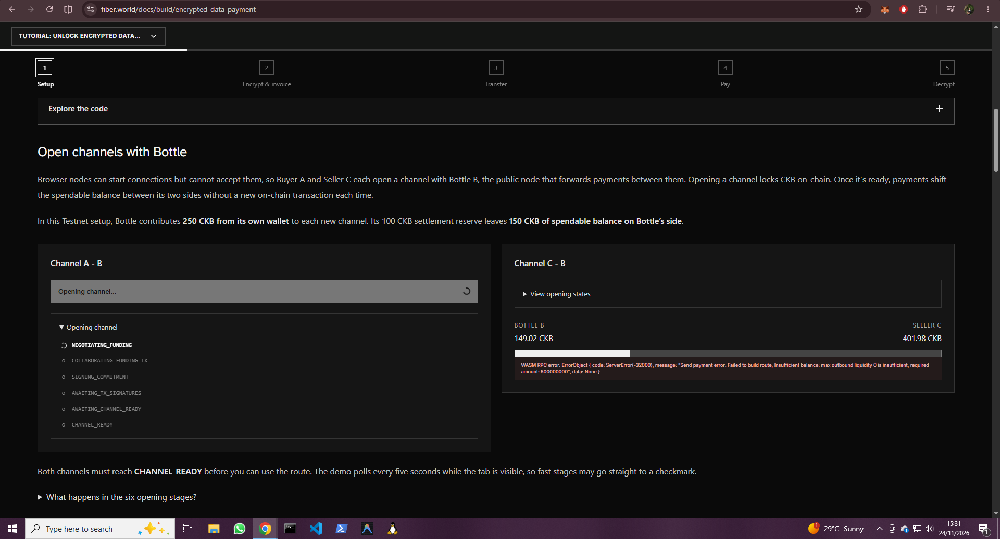

 ### How I Fixed It
 Discovered that the node for `Seller C` had insufficient balance to send the Payment thus failing to build the route so i funded the `testnet address` from **[Nervos-Faucets](https://faucet.nervos.org/)** 

### Submission Error
When I tried submitting my campaign details on the [CKB netlify app](https://ckboost.netlify.app/campaign) and funding it using`metamask` It kept on flagging it as an unsecure and malicious site forcing me to forcefully bypass the alert.**Kindly Check On That**
 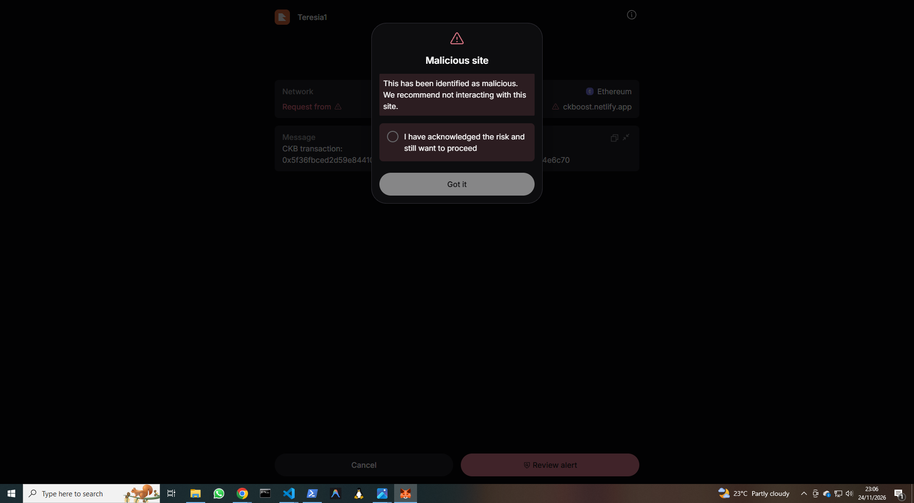
